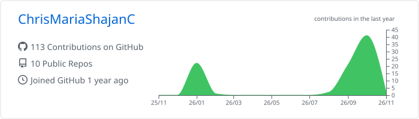

# Hi, I'm Chris Maria Shajan C 👋

I'm a Computer Science Engineering student passionate about technology, problem-solving, and building meaningful applications.

Currently exploring AI/ML and full-stack development while continuously learning and improving my skills.

---

<h2 align="center">📊 GitHub Analytics</h2>

---
<h2 align="center">🔥 GitHub Streak</h2>

---

---

<h2 align="center">🏆 GitHub Trophies</h2>

---

<h2 align="center">🐍 Contribution Snake</h2>

---

<h2 align="center">🔥 GitHub Streak & Contributions</h2>

<picture>
  <source media="(prefers-color-scheme: dark)" srcset="./assets/contributions.dark.svg">
  
</picture>
<h2 align="center">🌐 Connect With Me</h2>

&nbsp;

&nbsp;

---

